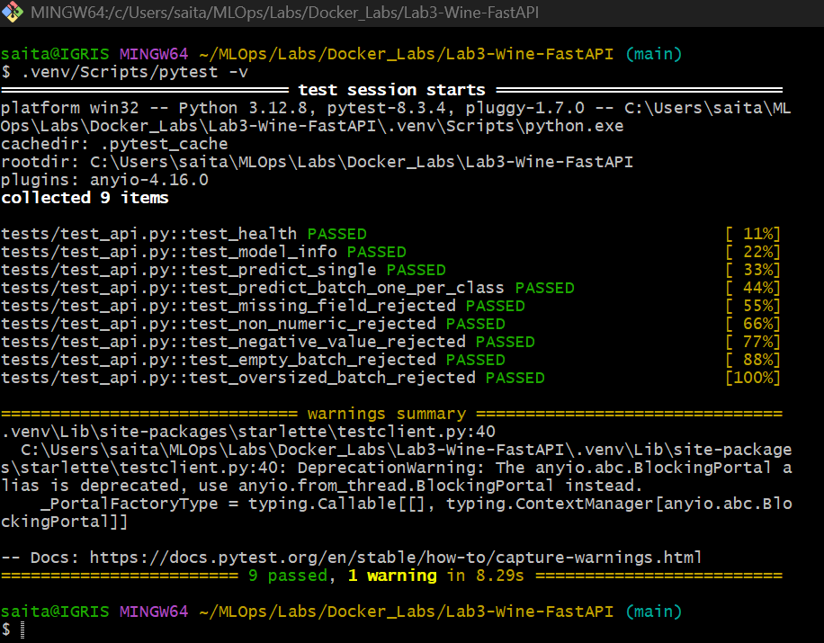
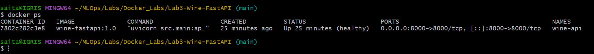
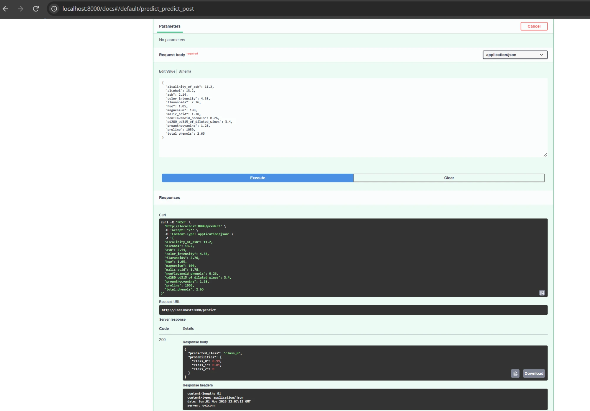
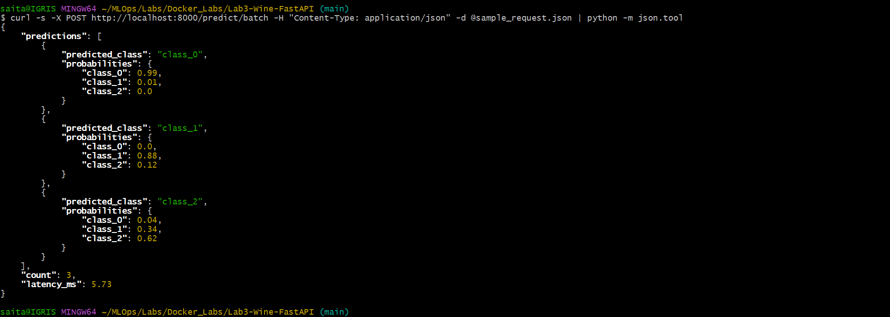
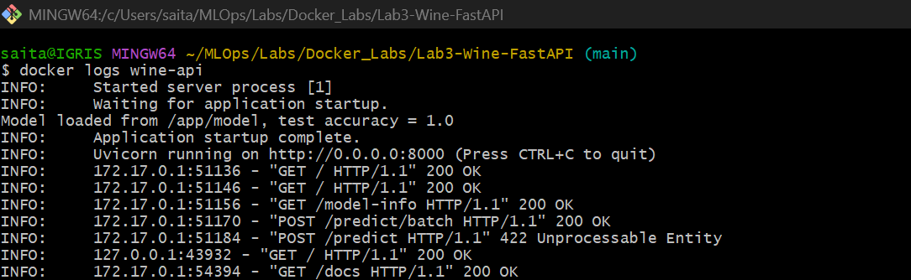

# Lab 3: Serving an ML Model with FastAPI in Docker

This lab combines **API_Labs → FastAPI_Labs** (an Iris model behind a FastAPI server) with
**Docker_Labs → Lab2** (a multi-stage Docker build that trains, then serves). It packages last week's
wine classifier as a REST API in a container that runs anywhere Docker runs, with no cloud account needed.

## What I changed from the original labs

| Original labs | This version |
|---|---|
| Iris dataset (4 features), Decision Tree | **Wine dataset** (13 features, 3 cultivars), **scikit-learn Pipeline** (StandardScaler + RandomForest) |
| Model loaded from disk on every request | Model loaded **once at startup** (FastAPI `lifespan`) |
| Returns a class index (`{"response": 0}`) | Returns **class names** and a **probability per class** |
| One `/predict` endpoint | `GET /` health, `GET /model-info`, `POST /predict` (one wine) and `POST /predict/batch` (**up to 100**, with latency) |
| Basic float fields | **Validated named fields**: missing, non-numeric or negative values and empty or oversized batches return **422** |
| `python:3.10` full image, runs as root | **`python:3.12-slim`**, multi-stage build (model trained at build time), **non-root user**, **`HEALTHCHECK`** |
| No tests | **pytest suite** (9 tests) using FastAPI's `TestClient` |

## Files

- `src/train.py`: trains the pipeline and saves `model/wine_model.joblib` and `model/metadata.json`
- `src/main.py`: the FastAPI app
- `tests/test_api.py`: API tests (they train their own model in a temp folder)
- `Dockerfile`: two stages, `model_training` then `serving`
- `requirements.txt` / `requirements-dev.txt`: runtime and test dependencies
- `sample_request.json`: a batch with one wine per cultivar
- `screenshots/`: proof that it runs

## Results

Built as `wine-fastapi:1.0` (570 MB) and run locally with Docker Desktop 29.1.3.

**1. Tests pass**: `9 passed`



**2. Image built and container running as `(healthy)`**: `docker ps` shows the HEALTHCHECK result



**3. Interactive API docs** at `http://localhost:8000/docs`: `POST /predict` returns 200 with `class_0`



**4. Batch prediction for 3 wine samples**, one per cultivar, all classified correctly



**5. Container logs**: the model loads once at startup, then one log line per request



---

## Prerequisites

- [Docker Desktop](https://www.docker.com/products/docker-desktop/), running (the whale icon in the system tray is steady)
- Python 3.12 (only needed for running the tests or running without Docker)

## Step 1: Build the image

From inside this folder:

```bash
docker build -t wine-fastapi:1.0 .
```

The first stage installs the dependencies and runs `src/train.py`. The second stage copies only the
trained `model/` folder and `main.py` into a fresh slim image. The first build takes about 1–2 minutes.

## Step 2: Run the container

```bash
docker run -d --name wine-api -p 8000:8000 wine-fastapi:1.0
```

```bash
docker ps
```

After about 10 seconds, the `STATUS` column should say `Up ... (healthy)`.

## Step 3: Test the API

**From the browser:** open <http://localhost:8000/docs>, expand **POST /predict**, click
**Try it out → Execute**. The example body is already filled in.

**From a terminal** (Git Bash, or PowerShell using `curl.exe`), run these from inside this folder:

```bash
curl http://localhost:8000/
```

```bash
curl http://localhost:8000/model-info
```

```bash
curl -X POST http://localhost:8000/predict/batch -H "Content-Type: application/json" -d @sample_request.json
```

Expected output:

```json
{"predictions":[
  {"predicted_class":"class_0","probabilities":{"class_0":0.99,"class_1":0.01,"class_2":0.0}},
  {"predicted_class":"class_1","probabilities":{"class_0":0.0,"class_1":0.88,"class_2":0.12}},
  {"predicted_class":"class_2","probabilities":{"class_0":0.04,"class_1":0.34,"class_2":0.62}}],
 "count":3,"latency_ms":6.7}
```

An error case (this should return HTTP 422 and list each problem field):

```bash
curl -X POST http://localhost:8000/predict -H "Content-Type: application/json" -d "{\"alcohol\":\"high\"}"
```

## Step 4: Check the logs

```bash
docker logs wine-api
```

You should see `Model loaded from /app/model, test accuracy = 1.0`, followed by one line per request.

## Step 5: Clean up

```bash
docker rm -f wine-api
```

```bash
docker rmi wine-fastapi:1.0
```

---

## Running the tests

```bash
python -m venv .venv
```

```bash
.venv/Scripts/pip install -r requirements-dev.txt
```

```bash
.venv/Scripts/pytest
```

## Running it without Docker (optional)

```bash
.venv/Scripts/python src/train.py
```

```bash
.venv/Scripts/uvicorn src.main:app --port 8000
```

## Troubleshooting

**Docker Desktop crashes on startup with `remove ...dockerInference` or `remove ...engine.sock`:
The file cannot be accessed by the system.** A socket file left behind by an earlier run is stuck and
Windows can't delete it. Quit Docker Desktop, rename the folder that holds it (for example
`%LOCALAPPDATA%\Docker\run` → `run.old`, or `%LOCALAPPDATA%\docker-secrets-engine` →
`docker-secrets-engine.old`) and start Docker Desktop again. It recreates the folders.
