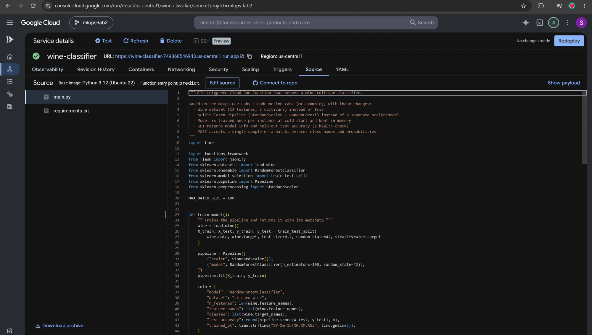
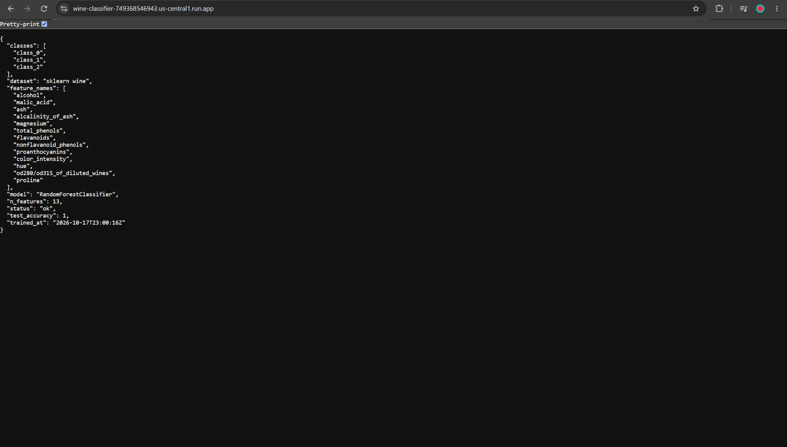
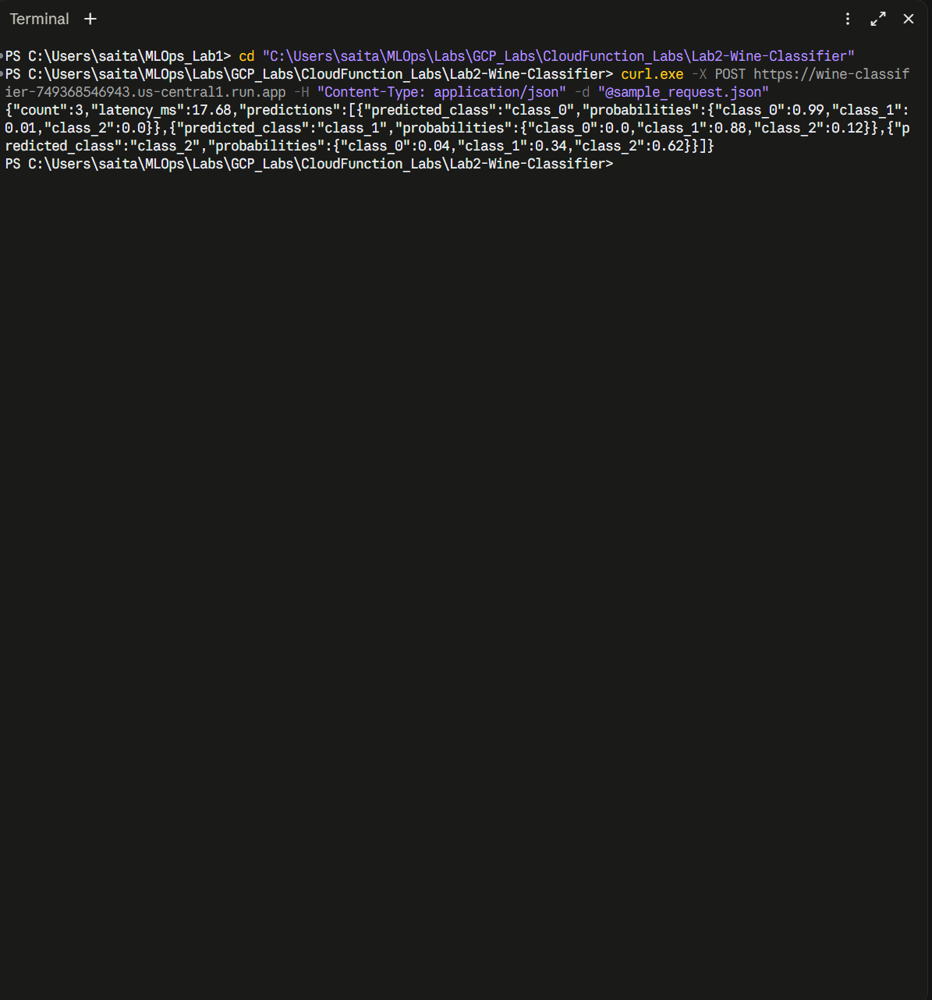
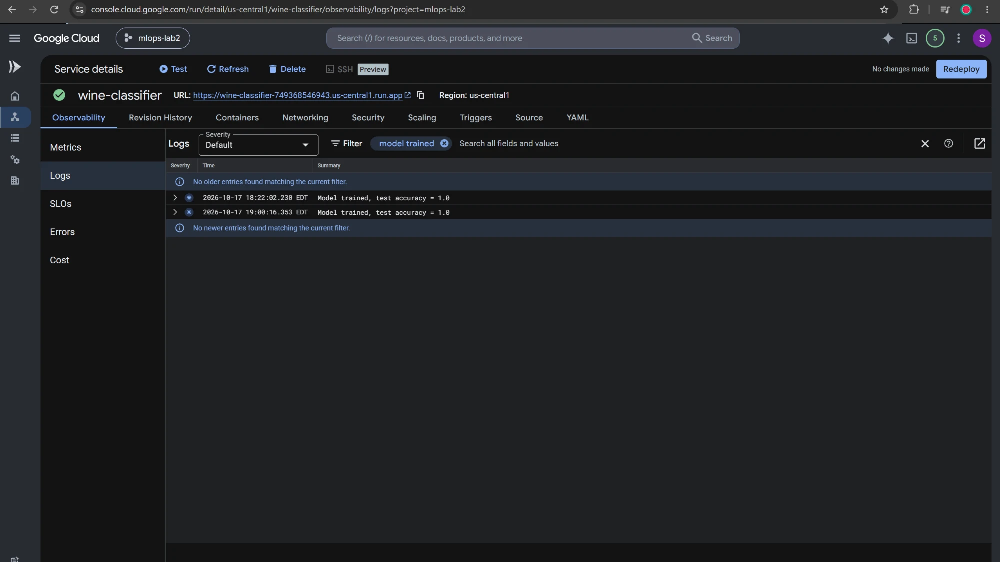

# Lab 2: Serving an ML Model with a Cloud Run Function (GCP)

This lab is based on **GCP_Labs → CloudFunction_Labs → Lab1 (ML-Example)**. It deploys an
HTTP-triggered serverless function on Google Cloud that trains a classifier and returns predictions.

## What I changed from the original lab

| Original lab | This version |
|---|---|
| Iris dataset (4 features) | **Wine dataset** (13 features, 3 cultivars) |
| Logistic Regression + separate scaler saved to `/tmp` | **scikit-learn Pipeline** (StandardScaler + RandomForest), trained once per instance and kept in memory |
| POST only, one sample at a time | **GET** returns model info and test accuracy (health check). **POST** accepts one sample or a **batch of up to 100** |
| Returns a class index | Returns **class names**, a **probability per class**, and the **inference latency** |
| Python 3.11 with old pins (numpy 1.21, sklearn 0.24) that no longer install | **Python 3.12** with current pins |
| Input validation | Stricter validation: rejects booleans/strings, wrong lengths and oversized batches, and returns 405 for other HTTP methods |

## Files

- `main.py`: function code (entry point: `predict`)
- `requirements.txt`: dependencies
- `sample_request.json`: an example batch request
- `screenshots/`: proof of the deployment on GCP

## Results (deployed on GCP)

Deployed as the Cloud Run service `wine-classifier` in project `mlops-lab2` (`us-central1`).

**1. Service deployed successfully** (Python 3.12, entry point `predict`)



**2. GET: health check and model info** (held-out test accuracy 1.0)



**3. POST: batch prediction for 3 wine samples**, one per cultivar



**4. Cloud Logging: the model trains on each cold start**



---

## Cost (with $50 in credits)

Cloud Run Functions has a monthly free tier of 2 million requests, which covers this lab.
You should spend essentially **$0**. To be safe:
1. Set up a budget alert (Step 1.4).
2. **Delete the function** once you've been graded (Step 6).

---

## Step 1: Set up your Google Cloud project (one time)

1. Go to <https://console.cloud.google.com> and sign in.
2. At the top, click the **project dropdown → New Project**. Name it something like `mlops-lab2` and click **Create**.
   Make sure the new project is selected in the dropdown.
3. Make sure your credits are linked: **☰ Menu → Billing**. The project should show the billing account that holds your credits.
   If it says "no billing account", click **Link a billing account** and choose it.
4. *(Recommended)* **Billing → Budgets & alerts → Create budget** and set the amount to **$5**. You'll get an email if spending gets close to it.

## Step 2: Create the function

1. In the top search bar, type **Cloud Run** and open it.
2. Under **Write a function**, click **Python**.
   If it asks you to enable APIs (Cloud Run, Cloud Build, Artifact Registry), click **Enable** and wait about a minute.
3. Fill in:
   - **Service name**: `wine-classifier`
   - **Region**: `us-central1` (the default may be `europe-west1`)
   - **Runtime**: `Python 3.12` (the default is 3.14, which the pinned numpy doesn't support)
   - **Authentication**: **Allow public access**, so you can call it with curl
   - **Billing**: Request-based. **Scaling**: auto, min `0`, max `2` (caps the cost)
4. Expand **Containers, Networking, Security**:
   - **Containers → Memory**: `1 GiB` (scikit-learn needs more than the default 512 MiB), then click **Done** on the container card.
     Otherwise it stays "Not saved" and the form won't submit.
   - **Security → Service account**: required. Pick the default compute service account, or create a new one
     (for example `wine-classifier-sa`) with no roles. This function doesn't call any other GCP APIs.
5. Click **Create**.

## Step 3: Add the code

1. The inline editor opens with a `main.py` and a `requirements.txt`.
2. Replace the contents of `main.py` with this repo's [`main.py`](main.py).
3. Replace the contents of `requirements.txt` with this repo's [`requirements.txt`](requirements.txt).
4. Set **Function entry point** to `predict`.
5. Click **Save and redeploy**. The build takes about 2–4 minutes. Wait for the green check mark.

## Step 4: Test it

Copy the **URL** shown at the top of the service page (it looks like `https://wine-classifier-xxxxx.us-central1.run.app`).

**From the browser:** paste the URL into the address bar. That sends a GET request, and you should see the model info and `test_accuracy`.

**From a terminal** (Git Bash, or PowerShell using `curl.exe`), run these from inside this folder:

```bash
curl https://YOUR-URL
```

```bash
curl -X POST https://YOUR-URL -H "Content-Type: application/json" -d @sample_request.json
```

Expected output (abridged):

```json
{"count":3,"latency_ms":11.8,"predictions":[
  {"predicted_class":"class_0","probabilities":{"class_0":0.99,"class_1":0.01,"class_2":0.0}},
  {"predicted_class":"class_1", ...},
  {"predicted_class":"class_2", ...}]}
```

An error case (this should return HTTP 400):

```bash
curl -X POST https://YOUR-URL -H "Content-Type: application/json" -d "{\"features\":[1,2,3]}"
```

## Step 5: Check the logs

On the service page, open the **Logs** tab. You should see `Model trained, test accuracy = 1.0`
from the cold start, followed by one log line per request.

📸 **Screenshots for submission:** the service page with its green check, the browser GET response,
the POST curl output, and the Logs tab.

## Step 6: Clean up (to avoid charges)

Go to **Cloud Run**, tick `wine-classifier`, and click **Delete**. Optionally, also delete the container
images under **Artifact Registry → cloud-run-source-deploy**, which use a few cents of storage per month.

---

## Running it locally (optional, no GCP needed)

```bash
python -m venv .venv
```

```bash
.venv/Scripts/pip install -r requirements.txt
```

```bash
.venv/Scripts/functions-framework --target=predict --port=8080
```

Then send the same curl commands to `http://localhost:8080`.
